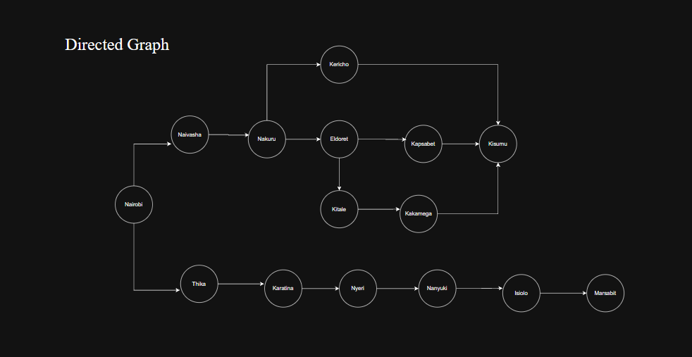
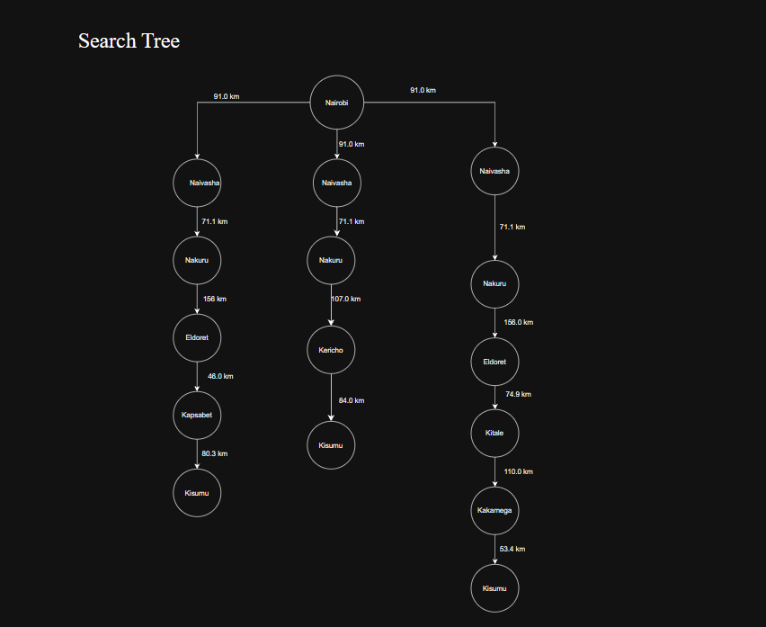

# Self-driving Trailer Agent

## 1. Design the agent using the PEAS framework and further define its environment using the 5 definitions of agent environments,
### PEAS framework
* Performative Measure: fuel efficient trip ,least time taken for trip
* Environment: roads, traffic law, pedestrians
* Actuators: steering wheel, accelerator, brake, horn
* Sensors: cameras, GPS, keyboard, sonar radar
### defining the environment
* Partially Observable Agent: Information about the environment is not fully available to the agent.It must make informed guesses.It has to know what to do when there's traffic.
* Stochastic: Other road users and changing road conditions make the outcomes of actions uncertain.
* Sequential: Choice of action by agent is dependent on previous actions.
* Dynamic: Environment can change while agent is selecting an action: a pedestrian crossing the road.
* Multi-agent: The trailer shares the environment with other drivers and pedestrians whose actions affect it.

## 2.Develop a suitable directed graph and search tree based on the map presented in class of Kenya’s Highway Network featuring cities and towns in the Nairobi, Central Highlands, Rift Valley and Lake Victoria Basin regions.

## 3. Using distance between towns as the path cost function, determine the optimal path the trailer can take from Nairobi to Kisumu. Calculate the distance between towns 
Nairobi-Naivasha-Nakuru-Eldoret-Kapsabet-Kisumu= 91.0 + 71.1 + 156 + 46 + 80.3 = 444.4

Nairobi-Naivasha-Nakuru-Kericho-Kisumu= 91.0 + 71.1 + 107.0 + 84.0 = 353.1 km (This is the most optimal path)

Nairobi-Naivasha-Nakuru-Eldoret-Kitale-Kakamega-Kisumu = 91.0 + 71.1 + 156 + 74.9 + 110 + 53.4 = 556.4 km

168970-Asiaba Bradley
190519-Dwalo Aaron Lawanda
189125-Wanjiru C Catherine Njoki

 
